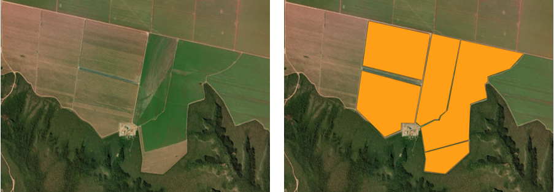
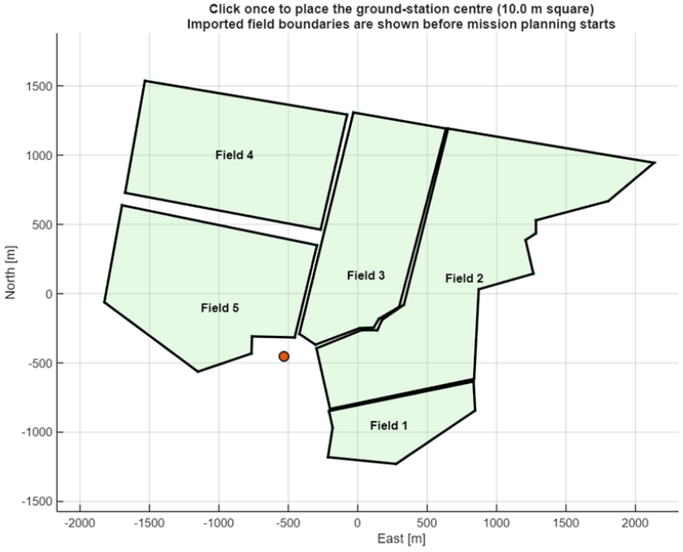
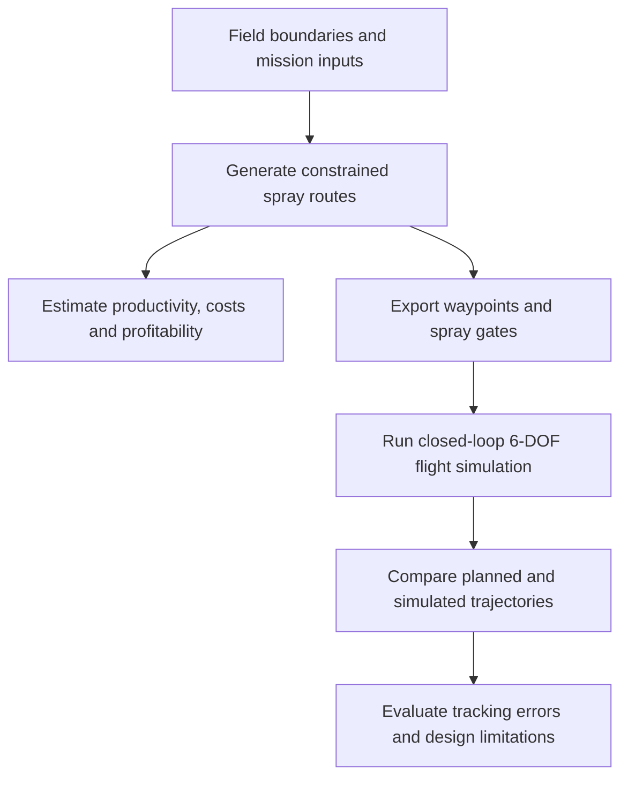
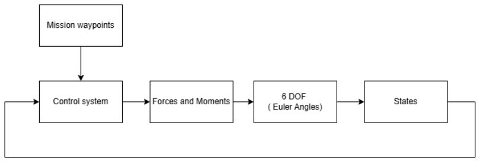
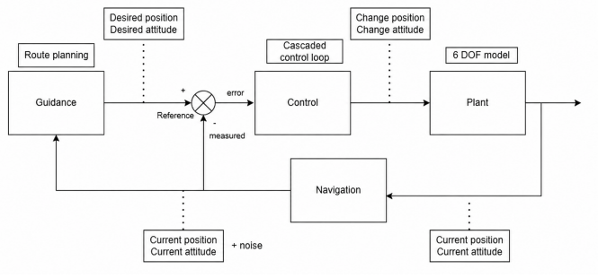
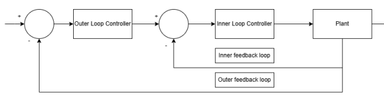
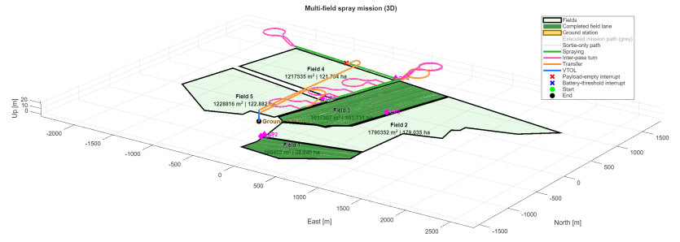
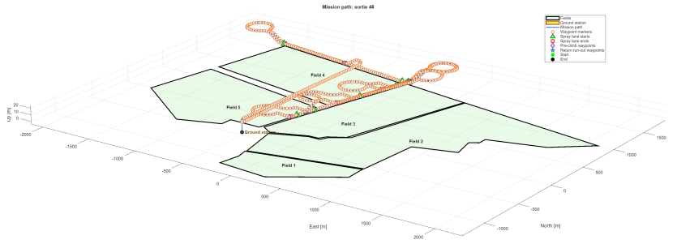
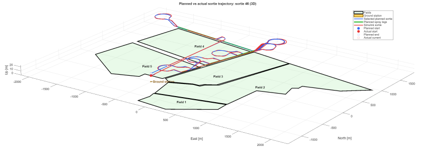

# Agricultural UAV Mission Planning and Flight Simulation

MATLAB and Simulink tools developed to assess the operational and commercial feasibility of a fixed-wing VTOL agricultural spray drone.

The project connects field geometry, automated route planning and mission economics to a six-degree-of-freedom (6-DOF) flight simulation. It investigates whether the proposed aircraft can follow its planned spray paths and how field geometry and operational assumptions affect productivity and profitability.

<p align="center">
  
</p>

*Original satellite area (left) and field polygons traced in QGIS (right). Satellite imagery: Esri World Imagery and its data providers.*

<p align="center">
  
</p>

*The same field boundaries imported into MATLAB from GeoJSON, with the selected ground-station position. Both images are cropped directly from the original report; surrounding report prose and captions have been removed.*

## Project context and my contribution

I developed the mission planner, flight simulation and analysis presented here as my **modelling and simulation contribution to an eight-person, third-year University of Bath Group Business Design Project** designing an agricultural spray drone.

My work connected three parts of the feasibility study:

- **Mission planning:** generate spray lanes, turning paths, field transfers and return-to-base segments while accounting for manoeuvrability, battery reserve and payload capacity.
- **Flight simulation and control:** export mission waypoints to a Simulink 6-DOF model, develop longitudinal and lateral controllers, and examine cross-track and altitude errors during spraying.
- **Operational and economic analysis:** estimate mission duration, resource use and profitability, and investigate the effects of aircraft and operating parameters.

The aircraft concept and subsystem design were team work. The simulation combines team-supplied design parameters with established aircraft modelling relationships, including aerodynamic equations from the Research Civil Aircraft Model (RCAM). It is a feasibility model using representative aerodynamic assumptions.

## From field boundaries to flight simulation

Field boundaries were defined from satellite imagery in QGIS and exported as GeoJSON. The planner imports those polygons and automatically generates the mission; it also supports interactively drawn rectangular fields.



*Adapted from Figure 13, page 16, of my May 2026 report, “Simulation and Modelling for Drone Applications: Agricultural Spray Drone Feasibility Study”.*

Route planning uses Dubins connections constrained by airspeed and bank angle. Battery and payload limits divide the mission into sorties, with ground turnaround included in mission accounting. The flight simulation then assesses tracking performance along the exported cruise route.

## 6-DOF model development

I developed the Simulink model to assess how the proposed aircraft would follow the mission planner's routes. The model combines six-degree-of-freedom equations of motion, aerodynamic forces and moments, propulsion, gravity, and changing payload mass and inertia during spraying.

Aircraft geometry and mission parameters came from the team's design. The aerodynamic formulation combines team-supplied lift data with representative RCAM-based coefficient relationships. These assumptions support a concept-level feasibility assessment; the model was not calibrated against flight-test data.

### Whole-system architecture

<p align="center">
  
</p>

*Original report Figure 33: closed-loop simulation architecture.*

Mission waypoints and the current aircraft states feed the control system. Control commands determine forces and moments, which drive the Euler-angle 6-DOF equations of motion. The resulting aircraft states are fed back to the controllers and used to assess trajectory tracking.

### Guidance and control architecture

<p align="center">
  
</p>

*Original report Figure 38: guidance, control and navigation architecture. The diagram includes a conceptual noise input; the reported simulations assumed ideal sensor measurements.*

The guidance stage converts the planned route into reference commands. Cascaded controllers separate the slower path-following response from the faster aircraft attitude response:

- **Longitudinal control:** altitude error generates a pitch command; the inner pitch loop commands elevator deflection.
- **Lateral control:** cross-track error generates a roll command; the inner roll loop commands aileron deflection.
- **Airspeed and sideslip:** throttle regulates cruise airspeed, while a rudder sideslip controller was investigated separately in the report.

<p align="center">
  
</p>

*Original report Figure 39: outer guidance and inner attitude-control loops.*

Spray start/end gates link payload release to the planned spray lanes. Tracking analysis compares the simulated trajectory with the planned route, including lane-level cross-track and altitude errors. The flight workflow begins at a cruise initial condition; vertical take-off and transition dynamics remain outside that workflow.

## Flight-tracking results

<p align="center">
  
</p>

*Initial planned route for Sortie 46.*

<p align="center">
  
</p>

*Generated waypoints passed to the flight simulation.*

<p align="center">
  
</p>

*Planned versus simulated trajectory. These plots are cropped from the original report and retain its simulation settings. Click a plot to open the image.*

The original report evaluated **181 simulated sorties**. In **173 sorties, more than 95% of spray time was spent within both the specified horizontal and vertical tracking-error bounds**. This measures simulated trajectory tracking; spray deposition and distribution were not modelled.

The weaker cases were also important. Some turns left insufficient time for lateral errors to settle before spraying began. The report investigated waypoint spacing and controller tuning as ways to improve tracking.

These are results from the original university study. The current repository example has its own defaults and ground-station placement; reproducing the historical batch statistics requires matching the original simulation settings.

## Engineering findings and limitations

The study indicated that the concept was best suited to large, open fields, where fewer turns allow more time in efficient fixed-wing flight. The economic analyses explore how field geometry, spray width, turnaround time and assumed operating rates affect that conclusion.

- **Tracking depends on route transitions.** Individual poor lane entries can be obscured by an otherwise strong sortie result, so lane-level errors matter alongside aggregate metrics.
- **Obstacle response was insufficient in the report's test.** A simulated power-line avoidance case did not provide sufficient clearance, motivating pre-flight obstacle mapping and more conservative routes.
- **The model assumes flat terrain, no wind and ideal sensor measurements.** The results establish performance under those assumptions.
- **Spray tracking does not establish treatment uniformity.** Deposition, drift and spray distribution require additional modelling.
- **VTOL transitions are simplified.** The supplied flight workflow begins at a cruise initial condition; it does not simulate the complete vertical take-off and transition sequence.
- **Energy use and profitability depend on assumed inputs.** They are modelled estimates rather than measured operational performance.

## Run the project

Use **MATLAB R2025b**, with UAV Toolbox, Simulink, Aerospace Blockset and Image Processing Toolbox. Compatibility with earlier releases has not been established.

Clone or download the repository, make its root your MATLAB Current Folder, then run:

```matlab
clearvars
close all
setupProject
runSmallExample
```

For the supplied five-field farm example, run `runMission` after setup. The baseline uses `SAFarmboundaries.geojson` and automatically places the ground station. Large missions can take several minutes to plan.

After planning a mission, simulate and inspect one sortie:

```matlab
selectedSortie = 1;
plotSortieWaypoints
prepareFlightSimulation
runFlightSimulation
compareSimulinkTrajectoryToPlan
plotSprayLaneCrossTrackError
```

See the **[running and analysis guide](docs/running-the-project.md)** for detailed setup, mission configuration, economics, batch tracking, figure generation and troubleshooting.

## Explore the repository

| Location | Contents |
| --- | --- |
| [Running and analysis guide](docs/running-the-project.md) | Full workflow and route-planning diagram |
| [Field inputs](docs/field-inputs.md) | File formats and coordinate conventions |
| [Validation notes](docs/validation.md) | Checks performed on the publication copy |
| [Mission defaults](config/defaultMissionConfig.m) | Planning, resource and economic assumptions |
| [Aircraft parameters](config/initialiseAircraft.m) | Aircraft, aerodynamic and trim parameters |
| `models/SIXDOF28.slx` | Supplied 6-DOF flight model |
| `analysis/` | Tracking, comparisons, sensitivity and economic studies |

Generated results are written under `outputs/` and excluded from Git.

## Attribution and licence

**Peter Eriksson — modelling and simulation**, University of Bath, third-year Group Business Design Project, May 2026. The wider agricultural spray drone concept was developed by an eight-person team; aircraft and subsystem inputs include their design work.

The modelling approach draws on established aircraft dynamics, RCAM aerodynamic relationships and MathWorks modelling tools. The original report records the underlying references. Satellite imagery used for field preparation: Esri World Imagery and its data providers, as cited in the original report. QGIS was used to define the boundary polygons.

A repository licence has not yet been assigned. MATLAB, Simulink and the required toolboxes are separate MathWorks products and are not included here.
