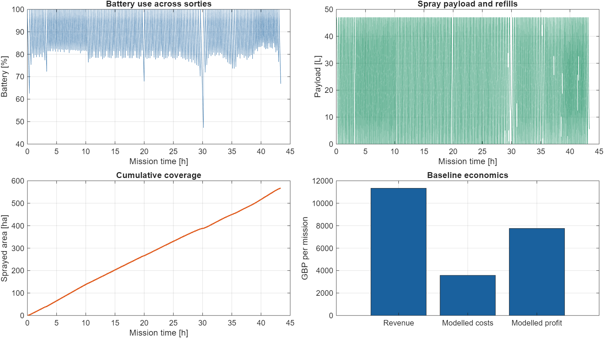
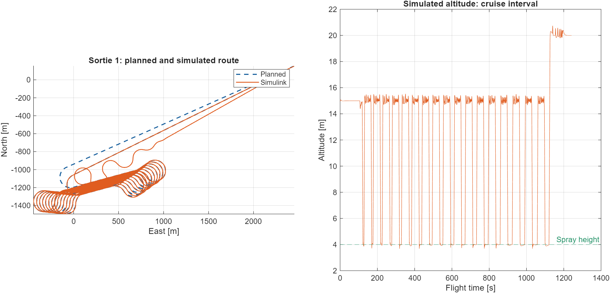
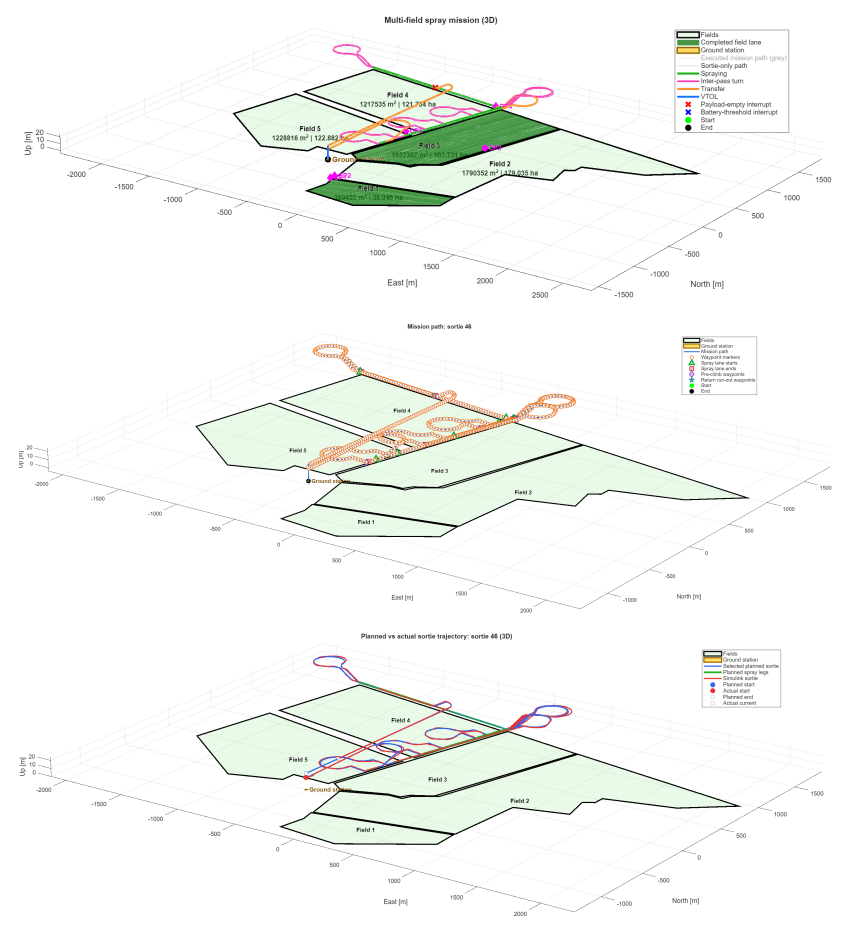
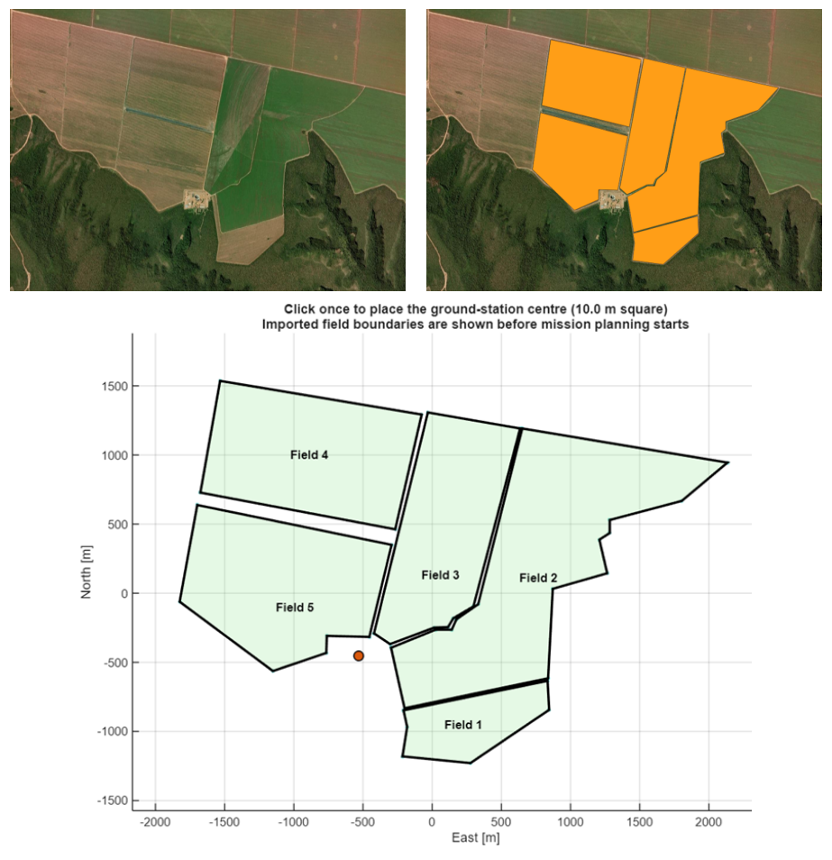
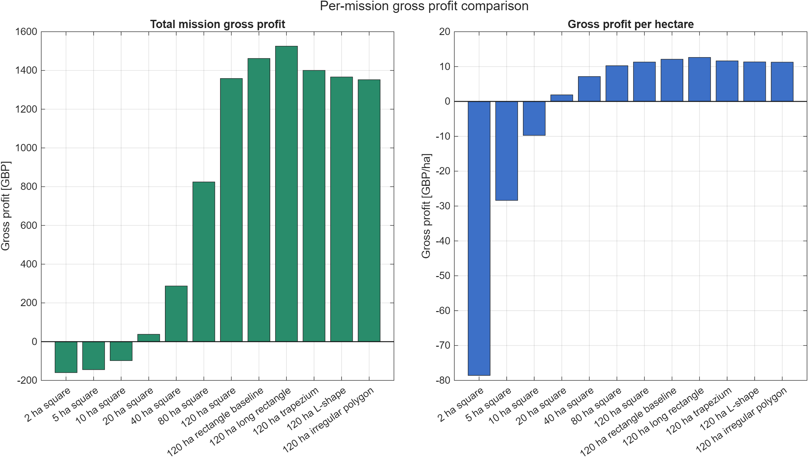
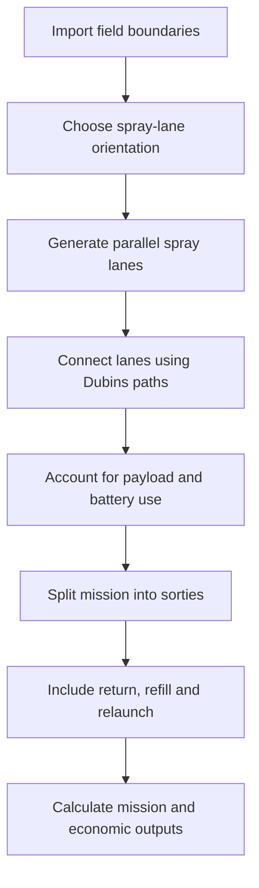

# Running and Extending the UAV Mission Planner

[Back to the project overview](../README.md)

## Requirements

Use **MATLAB R2025b** for the supplied model and the documented workflow. Compatibility with earlier releases has not been established.

| Product | Used for |
| --- | --- |
| MATLAB | Planning, mission accounting, figures and analysis |
| UAV Toolbox | `uavDubinsConnection` for flight-path connections |
| Simulink | Running `SIXDOF28.slx` |
| Aerospace Blockset | Flight dynamics and aerodynamic blocks in the model |
| Image Processing Toolbox | Interactive field/ground-station drawing tools |

The default field import does not require clicking through the drawing tools. Flight simulation is a separate step; planning and economic analysis can be explored first.

## Quick start: plan the SA farm mission

1. Download or clone this repository.
2. Open MATLAB and make the repository folder your **Current Folder**. It should contain `runMission.m` and `setupProject.m`.
3. Start with a clean workspace and set up the paths:

   ```matlab
   clearvars
   close all
   setupProject
   ```

4. Run the default mission:

   ```matlab
   runMission
   ```

   The SA farm boundaries load automatically. The ground station is placed just east of the field bounds, at their north-south midpoint. This deterministic position makes the example reproducible. Planning a large multi-field mission can take several minutes.

5. Inspect the mission playback, results dashboard and Command Window summary. The key workspace results are:

   | Variable | Contents |
   | --- | --- |
   | `missionCfg` | Field layout, aircraft/mission assumptions and economics |
   | `planningData` | Spray lanes, field order and planned base path |
   | `simulationData` | Sorties, time history, resource use and mission metrics |
   | `plotData` | Playback/display data |

For a smaller synthetic layout, run `runSmallExample` after `setupProject`. To return to the SA farm afterwards, set `layoutOptions = struct(); missionCfgOverrides = struct();` and run `runMission` again.

<p align="center">
  
</p>

*Battery and payload replenishment between sorties, cumulative spray coverage, and the mission's modelled financial totals.*

With the supplied defaults and automatic ground-station placement, the verified mission has **566.35 ha of field boundaries, 863 spray lanes and 181 sorties**, taking **43.38 modelled hours** including ground turnaround. These values describe the full farm mission, not one continuous flight. “Sprayed area” is derived from dispensed volume/application rate and can differ slightly from geometric field area; it is not a polygon-union coverage measurement.

## Run the flight model, step by step

Complete the planning steps above first. The repository includes **SIXDOF28**, the latest numbered model from the original project.

1. Choose a sortie and generate the waypoints:

   ```matlab
   selectedSortie = 1;
   plotSortieWaypoints
   ```

   This opens a waypoint figure and exports `waypoints` and `spraywaypoints` as cells indexed by sortie. The figure's sortie selector also updates `selectedSortie`.

2. Initialise the aircraft and configure the model:

   ```matlab
   prepareFlightSimulation
   ```

   This runs the aircraft parameter script and updates the model's route, spray gates, initial position, initial heading and stop time for the same sortie.

3. Run the simulation:

   ```matlab
   runFlightSimulation
   ```

   The simulation output is stored in `out`, including `out.Position`. Alternatively, after step 2, use `open_system('SIXDOF28')` and the Simulink **Run** button.

4. Compare the result:

   ```matlab
   compareSimulinkTrajectoryToPlan
   plotSprayLaneCrossTrackError
   ```

   The first plot overlays the routes. The second examines spray-lane cross-track and altitude errors. Keep `selectedSortie` consistent with the flight you simulated.

5. To inspect another sortie, change `selectedSortie` and repeat steps 1–4. Initialisation is handled for you; there is no need to edit numbered indices inside the model.

The mission planner uses **ENU** coordinates: `[East, North, Up]` in metres. The flight model and exported waypoints use **NED**: `[North, East, Down]`. Flight simulation starts at the exported cruise initial condition; it does not reproduce the planner's vertical take-off/hover sequence.

<p align="center">
  
</p>

*One sortie from the supplied flight model, shown over its planned cruise interval (excluding vertical flight and ground turnaround). The differences between the curves are part of the model's tracking performance; the simulated trace is not substituted for the planned route.*

<p align="center">
  
</p>

*Sortie 46 from the original project report: (a) initial plan, (b) generated waypoints and (c) path comparison. The plots retain their original simulation settings; surrounding report text and captions have been cropped out.*

## Change the mission

The common defaults live in [`config/defaultMissionConfig.m`](../config/defaultMissionConfig.m). For a temporary experiment, set overrides before running the mission:

```matlab
missionCfgOverrides = struct();
missionCfgOverrides.sprayWidth = 8;             % m
missionCfgOverrides.payloadLitres = 47;         % L
missionCfgOverrides.batteryReturnThreshold_pct = 25;
runMission
```

Nested planning options can be overridden individually:

```matlab
missionCfgOverrides = struct('planningOptions', ...
    struct('optimizeFieldVisitOrder', false));
runMission
```

Use `missionCfgOverrides = struct();` to restore the baseline. Mission settings do not automatically redesign or retrim the aircraft: aerodynamic and controller assumptions are in [`config/initialiseAircraft.m`](../config/initialiseAircraft.m) and the Simulink model.

To suppress the figures and printed summary:

```matlab
missionRunOptions = struct('createFigures',false,'printSummary',false);
runMission
```

Set `missionRunOptions = struct();` to restore normal display behaviour. For use inside your own functions, `runBaselineMission(overrides, layoutOptions)` returns the configuration, plan and mission simulation without modifying the base workspace.

## Use another field layout

Load a GeoJSON or CSV file:

```matlab
layoutOptions = struct('fieldPath', fullfile(pwd,'my-fields.geojson'));
runMission
```

Choose a ground station interactively on the default farm:

```matlab
layoutOptions = struct('selectGroundStation',true);
runMission
```

Or supply a repeatable local position, in metres:

```matlab
layoutOptions = struct('groundStationXY',[1000 -200]); % [East North]
runMission
```

Draw rectangular fields with `layoutOptions = struct('mode','interactive');`, then run `runMission`. See [field inputs and coordinate conventions](field-inputs.md) for file formats, saved layouts and importer limitations.

<p align="center">
  
</p>

*Field preparation from the original project report: satellite imagery is used to define boundary polygons, which are imported into MATLAB as GeoJSON. The lower figure shows interactive ground-station placement. Surrounding report text and captions have been cropped out. Satellite imagery: Esri World Imagery and its data providers.*

## Economics and other analyses

Run `setupProject` first. Each analysis has its editable settings near the top of its script.

| Command | Purpose | Required beforehand |
| --- | --- | --- |
| `compareDroneToDJIAgrasT50` | Simplified same-mission comparison using the script's T50 assumptions | `runMission` |
| `compareStandardToOptimalMission` | Baseline versus a selected one-minute turnaround scenario | Setup only; runs its own SA farm baseline |
| `runEconomicScenarioComparison` | Compare 12 field size/shape scenarios | Setup only |
| `runEconomicSensitivity120haRectangle` | Price and worker-rate sensitivity for a 120 ha rectangle | Setup only |
| `runMissionParameterSensitivityBarCharts` | One-at-a-time sweeps around the SA farm baseline | Setup only |
| `optimiseMissionParametersForProfit` | Search candidate mission/design parameters for higher modelled profit | Setup only |
| `createEconomicFigurePack` | Assemble the economic figures into panels | Scenario comparison and 120 ha sensitivity outputs |
| `plotMissionPath` | Interactive mission path and waypoint display | `runMission` |
| `plotElevationProfile` | Planned height/clearance profile | `runMission` |
| `plotPathTrackingDiagnostics` | Additional route-tracking diagnostics | Mission, waypoint export and flight output |

The economic studies intentionally retain their own price/cost assumptions; they are stated in their scripts. The scenario called “optimal” in the original comparison is a selected alternative, not a proof of global optimality. The profit search defaults to one coordinate-search iteration; increasing `maxIterations` permits multiple passes. Full parameter sweeps can be substantially slower than a single mission.

<p align="center">
  
</p>

*Results from `runEconomicScenarioComparison`, using that study's cost assumptions. The first scenarios vary field size; the final scenarios compare shapes at 120 ha.*

For the default SA farm and ground station, the simplified T50 model cannot reach the first lane and return with its assumed reserve. The comparison reports `agrasComparison.feasible = false` with an explanation and no T50 totals. This is a result of the comparator's assumptions and station placement, not a measured performance claim. Use a smaller/closer layout to obtain a feasible numerical comparison.

To run a small batch of flight-tracking analyses:

```matlab
% After runMission and plotSortieWaypoints:
sortieIndices = [1 2];
runAllSortieTrackingAnalysis
```

Set `sortieIndices = [];` to process all available sorties. Detailed trajectory/sample exports are disabled by default to keep generated files manageable; enable them in the script if needed.

## Files and generated output

```text
runMission.m                 Main planning and mission simulation entry point
prepareFlightSimulation.m    Aircraft and selected-sortie initialisation
runFlightSimulation.m        Run one Simulink sortie
setupProject.m               Session paths and output folders
exportReadmeFigures.m        Reproduce the README figures
config/                     Common mission and aircraft parameters
src/                        Core algorithms, validation and UI functions
models/SIXDOF28.slx          Latest aircraft flight model
analysis/                   Tracking, comparisons, sensitivity and economics
examples/                   Small demo, explanatory plots and input data
docs/                       Detailed usage notes and curated result images
tests/                      Small mission and configuration checks
outputs/                    Generated locally; excluded from Git
```

Economic figures and tables go to `outputs/economics/`; batch tracking results go to `outputs/tracking/`. Simulink caches also go under `outputs/`. Large historical outputs, older code/model versions and autosaves are not part of the repository. The small example `.mat` file is an input and is intentionally included.

To regenerate the mission/flight README images, run the default mission, export its waypoints, simulate a sortie, and call `exportReadmeFigures`. This writes to `docs/images/` intentionally. If the economic scenario results have already been generated, it also copies their profit-comparison figure into the README image folder. Standalone path illustrations are available as `visualizeDubinsFieldTransfer`, `visualizeOneSprayLaneClimbTurnDescent` and `visualizeRectangularSprayLaneGeneration`.

The two `report-*.png` images are cropped figure excerpts from the original project report, with surrounding prose and captions removed. They are preserved when `exportReadmeFigures` is run.

## Checks and troubleshooting

```matlab
setupProject
runSmokeTests
```

- **A function is missing:** make this repository the Current Folder and rerun `setupProject`. Avoid adding the old project and all its archived versions with `genpath`.
- **`uavDubinsConnection` is missing:** check that UAV Toolbox is installed and licensed.
- **Aircraft/waypoint variables are missing:** run `runMission`, `plotSortieWaypoints`, then `prepareFlightSimulation`, in that order.
- **A different `SIXDOF28` is already open:** close the old model before preparing the repository's model.
- **A comparison shows the wrong flight:** rerun the model for the chosen `selectedSortie`; an old `out` belongs to the previous flight.
- **The default layout has changed after an experiment:** reset `layoutOptions`, `missionCfgOverrides` and `missionRunOptions` to `struct()` and rerun the mission.

See [validation and cleanup notes](validation.md) for the checks performed on this publication copy.

## Modelling scope

This is an academic planning and simulation project. Battery use is calculated from prescribed power assumptions, and economics from specified rates and turnaround times. The supplied field example uses flat ground. The workflow does not model obstacle clearance, wind-dependent spraying or spray deposition/drift. Coverage and profitability figures are model outputs under those assumptions.

The T50 comparison is an analytical comparator with assumptions recorded in its script, not a measured head-to-head trial. Flight tracking and mission-level energy/economic models are separate stages.


## Route-planning workflow

The following diagram summarises Figure 17 (page 20) of Peter Eriksson's May 2026 project report.


